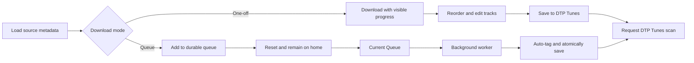

# VideoDL Queue to DTP Tunes

## Product flow

- **One-off:** metadata → start download with visible progress → `/order?jobId=…` when ready → reorder/edit → one **Save to DTP Tunes** action. Remove the ZIP and Navidrome-branded choices from the UI.
- **Queue:** metadata → enqueue → immediately clear/reset the form and stay on `/`; no individual progress takeover. The worker uses metadata order, tags, atomically saves, and requests a DTP Tunes scan automatically.
- Add a persistent **Current Queue** entry in the app header and a `/queue` page showing queued, downloading, finalizing, scan-pending, completed, failed, and cancelled jobs.

## 1. Durable SQLite queue and bounded worker

Refactor the current in-memory/thread-per-request orchestration out of [`api/main.py`](api/main.py) into focused modules under `api/app/`:

- `queue_store.py`: SQLite database at `${DATA_DIR}/queue.sqlite3`, WAL mode, schema initialization, parameterized CRUD, and atomic state transitions.
- `queue_worker.py`: one long-lived worker (configurable `MAX_DOWNLOAD_WORKERS`, default `1`) that leases jobs instead of creating unlimited daemon threads.
- `download_service.py` / `library_service.py`: extract and reuse yt-dlp progress parsing, manifest creation, track tagging, atomic library promotion, and cleanup from `main.py`.

Queue records retain source URL, mode, cookie preference, album metadata, cover path (store artwork in the job directory, not as a large SQLite blob), progress, timestamps, errors, retry count, output path, and manifest. States:

`queued → downloading → readyForReview` for one-off, or `queued → downloading → finalizing → savedScanPending → completed` for queue mode, with `failed` / `cancelled` terminal paths.

On process startup, recover stale `downloading` / `finalizing` leases back to `queued`; keep job directories so work is not silently lost. Add cancel for queued/running jobs, retry for failed jobs, and removal/clear for terminal history. Terminate the tracked yt-dlp subprocess on active cancellation.

## 2. Queue API and Next.js proxies

Add FastAPI endpoints in [`api/main.py`](api/main.py) or a new queue router:

- `POST /queue/jobs` — enqueue `{ mode, playlistUrl, useCookies, album, coverBase64 }`
- `GET /queue/jobs` — current/history list
- `GET /queue/jobs/{id}` — progress + manifest when ready
- `POST /queue/jobs/{id}/save` — one-off ordered tracks → tag, save, request scan
- `POST /queue/jobs/{id}/cancel`
- `POST /queue/jobs/{id}/retry`
- `DELETE /queue/jobs/{id}` — terminal jobs only

Add matching routes under [`ui/app/api/`](ui/app/api/) so the browser never needs direct backend access. Preserve the old endpoints temporarily for compatibility, but stop using them in the UI.

## 3. Home mode selection and non-blocking queue UX

Update [`ui/app/page.js`](ui/app/page.js) and [`ui/app/page.module.css`](ui/app/page.module.css):

- After metadata loads, show two clear actions: **One-off download** and **Add to queue**.
- One-off submits `mode: "oneOff"`, polls only that job, and routes to `/order?jobId=…` at `readyForReview`.
- Queue submits `mode: "queue"`, shows a brief queued confirmation, resets the metadata form, and remains on home without polling or showing that download's progress panel.
- Disable both actions while enqueueing to prevent duplicates.

Add a reusable header/navigation component in [`ui/app/layout.js`](ui/app/layout.js) with **Current Queue** and a live active-count badge, using CSS Modules and the existing dark/hot-pink visual language.

## 4. Current Queue page

Create `ui/app/queue/page.js` + CSS module:

- Poll the queue list while any jobs are non-terminal.
- Show album/source metadata, cover, mode, status, current title, item counts, progress bar, and timestamps.
- Actions: cancel queued/running, retry failed, open one-off jobs ready for review, remove terminal jobs, and clear completed history.
- Do not expose filesystem paths or secrets in API responses.
- Use empty, loading, error, and disabled/busy states consistently.

## 5. One-off reorder/save flow

Update [`ui/app/order/page.js`](ui/app/order/page.js) and its CSS:

- Load the manifest by `jobId` from the queue API instead of single-use `sessionStorage`.
- Keep track reorder/title editing.
- Replace both existing finalize buttons with one **Save to DTP Tunes** button.
- Save through `/queue/jobs/{id}/save`, show progress/disabled state, then show success with links back to Home and Current Queue.
- Remove Navidrome wording and ZIP download from this flow; leave legacy backend ZIP support untouched for compatibility unless later removed explicitly.

## 6. Shared DTP Tunes library destination

Update both dtp-videodl compose files and add `.env.example`:

- `MUSIC_HOST_PATH` is the single host-side library setting.
- Mount it RW into dtp-videodl at `/music` and set `MUSIC_LIBRARY_ROOT=/music`.
- Point it to the same host folder used by dtp-tunes (`/Users/argo/Music/Navidrome` locally); dtp-tunes keeps the same folder mounted RO.
- Replace hardcoded `/mnt/yuna/navidrome/music` and `/data/library` behavior with env substitution and document that both stacks must use the same path.
- Since ZIP is no longer browser-facing, bind the FastAPI diagnostic port to loopback instead of all interfaces; web proxies continue over the internal Compose network.

## 7. Secure immediate scan handoff

Add an internal ingestion endpoint to dtp-tunes rather than storing a user's admin credentials in VideoDL:

- Add `DTP_TUNES_INGEST_TOKEN` to both projects' env examples/config.
- Add `POST /api/internal/scan` in dtp-tunes, enabled only when the token is configured, validating `Authorization: Bearer …` with constant-time comparison, and enqueueing the existing scan job.
- VideoDL calls `${DTP_TUNES_API_URL}/api/internal/scan` after an atomic library promotion.
- If files save but the scan request fails, retain `savedScanPending` and retry the scan separately; never redownload or overwrite the completed album just because scan signaling failed. The existing periodic dtp-tunes scan remains a fallback.
- Update the dtp-tunes scanner to skip hidden staging/backup directories so a coincident scan cannot index partial atomic-write directories.

## 8. Verification and documentation

- Add unit tests for SQLite queue transitions, startup recovery, concurrency/lease behavior, cancellation/retry, and persistence across store re-instantiation.
- Add API tests for enqueue/list/detail/save and invalid state transitions.
- Add dtp-tunes tests for ingest-token auth and hidden-directory scanner exclusion.
- Run backend tests, Next.js lint/build for dtp-videodl, and dtp-tunes API tests.
- Update both READMEs with mode behavior, queue lifecycle, shared path setup, scan-token generation/configuration, failure recovery, and backup guidance for `${DATA_DIR}/queue.sqlite3`.

## Remaining product gaps (document, do not block V1)

- VideoDL itself has no user authentication; keep it private/loopback until auth is added.
- Album overwrite semantics currently replace the existing destination atomically; surface a clear queue failure/message rather than silently merging.
- Queue mode intentionally skips manual ordering, so metadata/source order is authoritative.
- DTP Tunes cataloging is asynchronous; “completed” means files were saved and a scan was accepted, not necessarily that every track is already visible in search.
