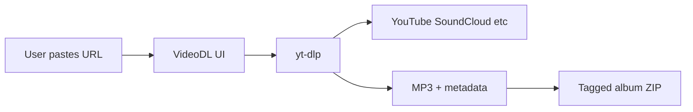

# Generic VideoDL copy update

## Scope

**In scope:** User-facing strings only (UI labels, placeholders, descriptions, notifications, README, metadata, docker env). No API contract changes (`playlist_url`, cookie file paths on disk, yt-dlp flags).

**Out of scope:** YouTube Channel Uploads Playlist tool on waifuDOTbond (stays YouTube-specific by design), backend logic changes, cookie upload mechanics.

## dtp-videodl changes

### 1. Rebrand Playlist2Album → VideoDL

| File | Current | Proposed |
|------|---------|----------|
| [`ui/app/layout.js`](file:///Users/argo/Code/dtp/dtp-videodl/ui/app/layout.js) | title/description | `VideoDL` / generic description |
| [`ui/app/page.js`](file:///Users/argo/Code/dtp/dtp-videodl/ui/app/page.js) | notifications, hero | `VideoDL` branding |
| [`README.md`](file:///Users/argo/Code/dtp/dtp-videodl/README.md) | `# Playlist2Album` | `# VideoDL` + updated feature list |
| [`docker-compose.yml`](file:///Users/argo/Code/dtp/dtp-videodl/docker-compose.yml) | `NEXT_PUBLIC_APP_NAME=Playlist2Album` | `VideoDL` |
| [`docker-compose.local.yml`](file:///Users/argo/Code/dtp/dtp-videodl/docker-compose.local.yml) | same | same |
| [`api/main.py`](file:///Users/argo/Code/dtp/dtp-videodl/api/main.py) | FastAPI title, User-Agent | `VideoDL API`, `VideoDL/1.0` |

Keep the in-app hero **"Playlist → Album"** as the workflow tagline (it still describes what the app does), with a generic subtitle underneath.

### 2. Generalize source/site copy in [`ui/app/page.js`](file:///Users/argo/Code/dtp/dtp-videodl/ui/app/page.js)

Key string updates:

- **Subtitle:** "Download playlists and tracks from YouTube, SoundCloud, and other supported sites as tagged MP3 albums"
- **URL label:** `Playlist or track URL` (id `playlistUrl` unchanged)
- **Placeholder:** multi-example, e.g. `https://youtube.com/playlist?list=... or https://soundcloud.com/artist/sets/...`
- **Cookies label:** `Cookies (optional)` with helper line: "For age-restricted or login-required content on supported sites (e.g. YouTube)"
- **Progress:** `Downloading X of Y tracks...` (not "videos")
- **Errors/notifications:** `Failed to download` / `VideoDL complete!` / `There was an error downloading.`
- **Cover hint:** `Auto-filled from source` (not "from playlist")

### 3. README rewrite ([`README.md`](file:///Users/argo/Code/dtp/dtp-videodl/README.md))

- Title: **VideoDL**
- Features/requirements/usage: refer to "playlist or track URL" and name YouTube + SoundCloud as examples
- Legal note: broaden from YouTube-only ToS to a generic "ensure you have rights / site terms may prohibit downloading"

## waifuDOTbond changes

### 1. [`src/components/VideoDownloader.js`](file:///Users/argo/Code/atos/waifuDOTbond/src/components/VideoDownloader.js)

- **`detectPlatform`:** add `soundcloud.com` → `SoundCloud`
- **Title:** `Download Media` (covers MP4 + MP3)
- **Description:** mention video and audio from social/streaming sites
- **Placeholder:** add SoundCloud, e.g. `Paste TikTok, YouTube, SoundCloud, Instagram, or other links...`
- **Supported Platforms list:** add `SoundCloud` badge

### 2. [`src/lib/toolsRegistry.js`](file:///Users/argo/Code/atos/waifuDOTbond/src/lib/toolsRegistry.js)

- **shortDescription** for `video-downloader`: include SoundCloud and "audio" alongside video, e.g. "Download video and audio from TikTok, YouTube, SoundCloud, Instagram, and more without ads or tracking."

No CSS changes expected (platform badges use the same `.platform` class).

## Verification

**dtp-videodl**
- Grep for remaining `YouTube` / `Playlist2Album` in user-facing files (`ui/`, `README.md`, `docker-compose*.yml`)
- Smoke: load UI, confirm new labels/placeholder render; metadata + download still work with a YouTube URL (no logic change)

**waifuDOTbond**
- Paste a SoundCloud URL in the tool → badge shows "SoundCloud"
- Tile description on home tools grid reflects updated copy
