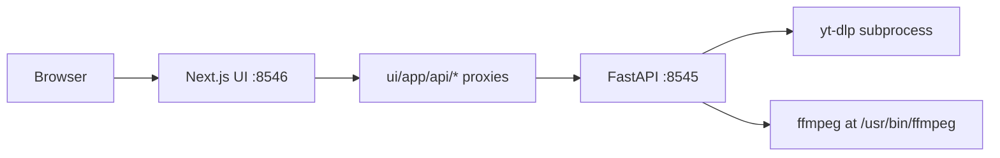
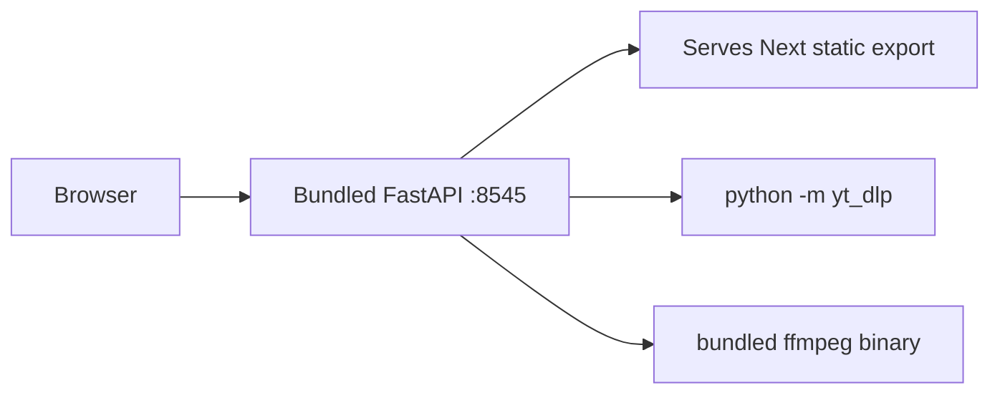

# macOS Standalone App for dtp-videodl

## Short answer

**Yes, it is feasible.** Effort is **medium, not huge** — roughly **3–5 days** for a working unsigned `.app`, plus another **1–2 days** if you want proper code signing + notarization for distribution to other Macs.

The app is already local-first and small. The main work is **replacing Docker’s two-container runtime** with a **single bundled launcher** and **vendoring ffmpeg**.

---

## Current architecture (why packaging is non-trivial)

Key constraints in the repo today:

- **Two runtimes**: Python API ([`api/main.py`](api/main.py)) + Next.js UI ([`ui/`](ui/))
- **Docker-only workflow**: [`docker-compose.local.yml`](docker-compose.local.yml)
- **Hardcoded ffmpeg path** in [`api/main.py`](api/main.py) (`--ffmpeg-location /usr/bin/ffmpeg`)
- **UI proxies** all API calls through Next server routes ([`ui/app/api/*/route.js`](ui/app/api/metadata/route.js)) instead of calling FastAPI directly
- **yt-dlp** is already a pip dependency, but invoked as a CLI subprocess (good news: can switch to `python -m yt_dlp` and avoid a separate binary)

---

## Recommended approach: single-process FastAPI + static UI

Best tradeoff for a true standalone `.app` without shipping Node:

### Why this path

| Approach | Standalone? | Effort | Notes |
|---|---|---|---|
| Docker wrapper `.app` | No | Low | Still needs Docker Desktop |
| PyInstaller API + Next standalone Node | Yes | Medium-High | Ships Node runtime (~extra 50MB+) and two processes |
| **FastAPI serves static UI (recommended)** | **Yes** | **Medium** | One process, one binary, smallest mental model |

CORS is already configured in [`api/main.py`](api/main.py) for `localhost:8546`, so the UI can talk to FastAPI directly once proxy routes are removed.

---

## Implementation plan

### 1. Make the UI callable without Next server routes (~0.5–1 day)

- Add `output: 'export'` to [`ui/next.config.js`](ui/next.config.js) for a static build
- Replace all `fetch("/api/...")` calls in [`ui/app/page.js`](ui/app/page.js) and [`ui/app/order/page.js`](ui/app/order/page.js) with `fetch(`${API_BASE}/...`)` using `NEXT_PUBLIC_API_BASE` (default `http://127.0.0.1:8545`)
- Keep proxy routes only for local dev if desired, or delete [`ui/app/api/`](ui/app/api/) for production builds
- Verify both pages still work: they are client components using `sessionStorage`, so static export is compatible

### 2. Serve the UI from FastAPI (~0.5 day)

In [`api/main.py`](api/main.py):

- Mount static files from a bundled `ui/out/` directory via `StaticFiles`
- Add a catch-all route for SPA-style navigation (`/` and `/order`)
- Keep existing API endpoints unchanged

### 3. Fix external tool paths for bundling (~0.5 day)

In [`api/main.py`](api/main.py):

- Replace hardcoded `/usr/bin/ffmpeg` with a resolver, e.g.:
  - `FFMPEG_PATH` env var
  - fallback to `shutil.which("ffmpeg")`
  - fallback to `Path(sys._MEIPASS) / "bin/ffmpeg"` when frozen (PyInstaller)
- Change yt-dlp invocations from `"yt-dlp"` to `[sys.executable, "-m", "yt_dlp", ...]` so the pip-installed module works inside the bundle

### 4. Bundle as a macOS `.app` with PyInstaller (~1–2 days)

Add packaging files under something like `packaging/macos/`:

- `playlist2album.spec` (PyInstaller spec)
- `launcher.py` — starts uvicorn on `127.0.0.1:8545`, opens browser, handles graceful shutdown
- Bundle contents:
  - Python + FastAPI + yt-dlp + mutagen
  - Static UI build (`ui/out/`)
  - **ffmpeg static binary** for macOS (arm64; add universal/fat binary if Intel support needed)
  - Default `data/` directory under `~/Library/Application Support/Playlist2Album/`

Expected `.app` size: roughly **120–200 MB** (mostly ffmpeg).

### 5. Polish the macOS app shell (~0.5 day)

- `.app` name/icon (e.g. `Playlist2Album.app`)
- Menu bar or dock launcher behavior
- First-run checks (writable data dir, port-in-use message)
- Optional: build script `packaging/macos/build.sh` that runs `npm run build` in `ui/` then PyInstaller

### 6. Distribution hardening (optional, +1–2 days)

Only needed if sharing with other people:

- Apple Developer code signing
- Notarization + stapling (avoids Gatekeeper “unidentified developer” warnings)
- Universal binary (Apple Silicon + Intel) if you need both archs

---

## What you would NOT need to change

- Core download/tagging logic in [`api/main.py`](api/main.py)
- UI styling or page flow
- DynamoDB/S3/cloud infra (none exists)
- Docker files can remain for dev/server deploy; native packaging is additive

---

## Effort summary

| Phase | Time |
|---|---|
| UI static export + direct API calls | 0.5–1 day |
| FastAPI static serving + path fixes | 0.5–1 day |
| PyInstaller bundle + ffmpeg vendoring | 1–2 days |
| macOS polish (icon, launcher, data dir) | 0.5 day |
| Code signing + notarization (optional) | 1–2 days |
| **Total** | **3–5 days** (unsigned), **4–7 days** (distribution-ready) |

**Verdict: not a big rewrite**, but more than a one-afternoon task because of ffmpeg bundling, the two-service split, and macOS packaging quirks.

---

## Simpler fallback (if you want something faster first)

If you later decide “standalone” can mean “no manual setup” but Docker is OK:

- A Platypus/Automator `.app` that runs `docker compose -f docker-compose.local.yml up` and opens the browser
- **Effort: ~2–4 hours**
- Still requires Docker Desktop installed

You selected true standalone, so the FastAPI + static UI + PyInstaller path above is the right target.
