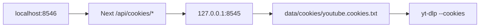
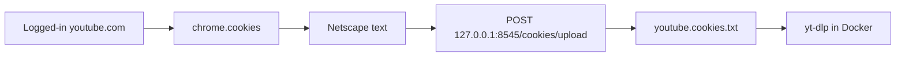

# Auto-sync YouTube cookies from dtp-os

## How local VideoDL deployments work today

Two compose files, both loopback-only:

- Local: [`docker-compose.local.yml`](docker-compose.local.yml) — `docker compose -f docker-compose.local.yml up --build`
  - UI `http://localhost:8546`, API `http://127.0.0.1:8545`
  - Music defaults to `./data/library` unless `MUSIC_HOST_PATH` is set
  - Cookies live at **`./data/cookies/youtube.cookies.txt`** (`COOKIES_DIR=/data/cookies` on the `./data` volume)
- Production-style: [`docker-compose.yml`](docker-compose.yml) — requires `MUSIC_HOST_PATH`; cookies mount is `${COOKIES_HOST_PATH:-./data/cookies}` → `/cookies`

yt-dlp already uses `--cookies` when that file exists ([`api/app/download_service.py`](api/app/download_service.py) `build_yt_dlp_cmd`). The UI still requires a manual Netscape upload ([`ui/app/page.js`](ui/app/page.js) → `POST /cookies/upload`).

Fully automatic from **inside the Linux API container** is not possible: Chrome/Safari cookie DBs are encrypted with the Mac Keychain. The extension approach works because dtp-os already runs in the same Chrome profile you use to log into YouTube.

## Approach

A new **VideoDL Cookies** popup tool in dtp-os (this is the existing wishlist item “get local cookies”). On Sync (or a periodic alarm), the service worker:

1. Requests optional `cookies` permission if not granted
2. Reads YouTube + Google auth cookies via `chrome.cookies.getAll`
3. Converts them to Netscape format (including `#HttpOnly_` prefixes)
4. POSTs multipart `file` to `http://127.0.0.1:8545/cookies/upload` (existing VideoDL endpoint — no new API required)
5. Shows count + last-synced time only — never cookie values

Keep the existing VideoDL upload UI as a fallback for non-Chrome / remote hosts.

## dtp-os changes

**Permissions** in [`manifest.json`](manifest.json):

- Add `"cookies"` to `optional_permissions` (do not make it required — that would scare every dtp-os user)
- Add `"alarms"` to `permissions` (needed to wake the MV3 worker for auto-refresh)
- Host permissions already include `https://*/*` and `http://127.0.0.1/*`
- Bump version `1.1.0` → `1.2.0`

**Shared lib** `js/lib/videodlCookieSync.js`:

- Domain allowlist only: `youtube.com`, `youtu.be`, `youtube-nocookie.com`, `google.com`, `googleapis.com`, `gstatic.com`, `ggpht.com`, `googlevideo.com`, `googleusercontent.com` (never dump the whole cookie jar)
- Netscape lines from `chrome.cookies.Cookie` (`domain`, `hostOnly` → include-subdomains flag, `path`, `secure`, `expirationDate` or `0` for session, `name`, `value`; prefix `#HttpOnly_` when `httpOnly`)
- Warn if no login cookies (`SID` / `__Secure-1PSID` / `LOGIN_INFO` / `SAPISID`)
- `assertLoopbackApiUrl(url)` — only `http://127.0.0.1` or `http://localhost`; reject anything else
- Upload with `FormData` field name `file` (matches FastAPI `UploadFile = File(...)`)
- Never log names/values; persist `{ lastSyncedAt, cookieCount, lastError }` in `chrome.storage.local`

**Settings** `js/lib/videodlCookieSettings.js` (camelCase): `videodlCookieApiUrl` default `http://127.0.0.1:8545`, `videodlCookieAutoSync` default **false**, `videodlCookieIntervalMinutes` default `360` (6h)

**Popup tool** `js/videodlCookiesTool.js` (pattern: Apply Copilot + Copy Section):

- Status: VideoDL reachable / last sync / cookie count / signed-in warning
- **Sync now** via `createCossButton`
- Auto-sync **Switch** via `createCossSwitchField` (opt-in)
- Optional API URL field (loopback-validated)
- Wire into [`js/toolSettings.js`](js/toolSettings.js), [`js/popup.js`](js/popup.js), [`js/toolIcons.js`](js/toolIcons.js) + a small SVG under `assets/tools/`

**Background** [`background.js`](background.js):

- Message `dtp-videodl-cookies-sync` so popup and alarms share one path
- `chrome.alarms` create/clear when auto-sync toggles; run sync on alarm
- Failures stay in `lastError` (VideoDL not running is expected)

**Docs:** [`docs/architecture.md`](docs/architecture.md), [`README.md`](README.md), check off wishlist “get local cookies”.

## VideoDL changes (small)

No new cookie protocol. Document the extension path in [`README.md`](README.md) and a one-line helper on the home-page cookies section in [`ui/app/page.js`](ui/app/page.js). Optional: store `source: "dtp-os"` in `youtube.cookies.meta.json` if `User-Agent` or a form field identifies the extension — skip unless it stays a one-liner.

Do not send cookies through the Next.js UI APIs (README already forbids exposing cookies in the browser app). Extension → API loopback only.

## Constraints / caveats

- You must be logged into YouTube **in the same Chrome profile** that has dtp-os loaded
- VideoDL Docker must be running for a sync to land
- YouTube bot-checks can still fail even with fresh cookies (PO tokens, etc.) — this only removes the manual export step
- Chrome will prompt once for cookie access when the user first syncs (optional permission)

## Verification

- Load unpacked dtp-os, open the tool, grant cookies, Sync now while logged into youtube.com
- Confirm `GET http://127.0.0.1:8545/cookies/status` shows `hasCookies` and a new `uploadedAt`
- Confirm `./data/cookies/youtube.cookies.txt` exists and looks like Netscape (do not paste values into chat/docs)
- Toggle auto-sync, confirm an alarm is created (`chrome://extensions` → service worker → `chrome.alarms.getAll`)
- Confirm a non-loopback API URL is rejected
- Confirm VideoDL metadata/download with “use cookies” still works against an age-restricted or logged-in-only URL
- Confirm declining the cookies permission leaves other dtp-os tools working
